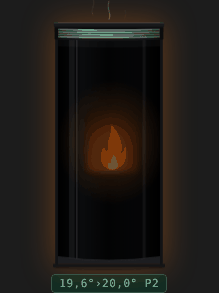
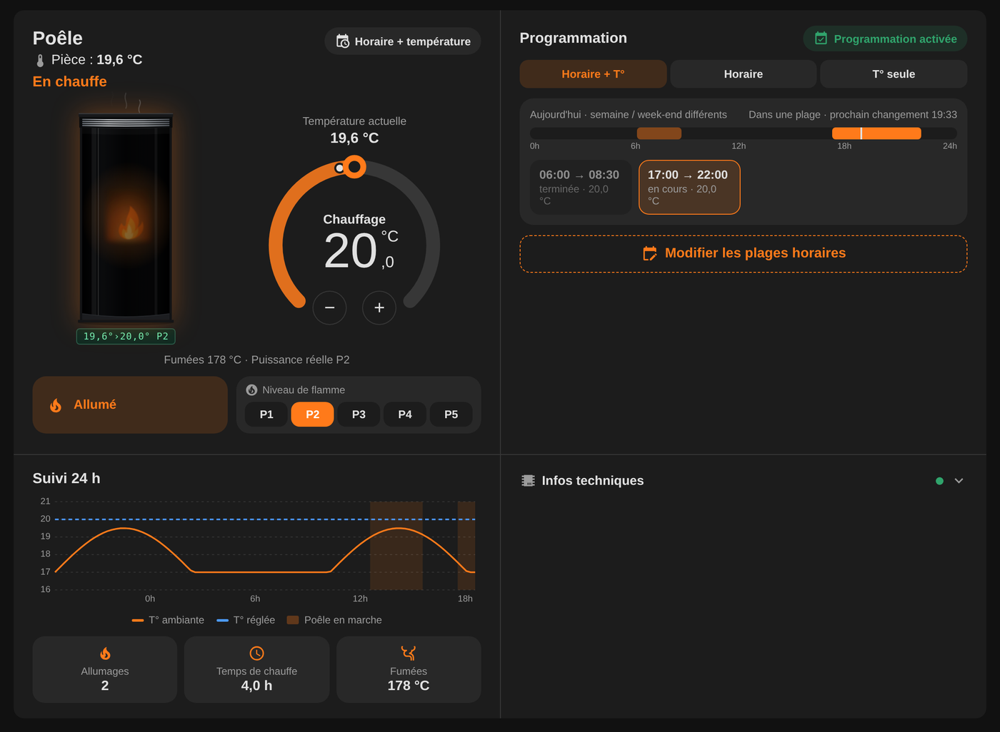
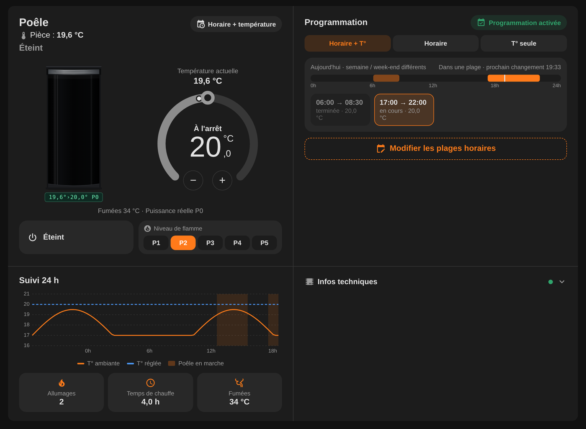
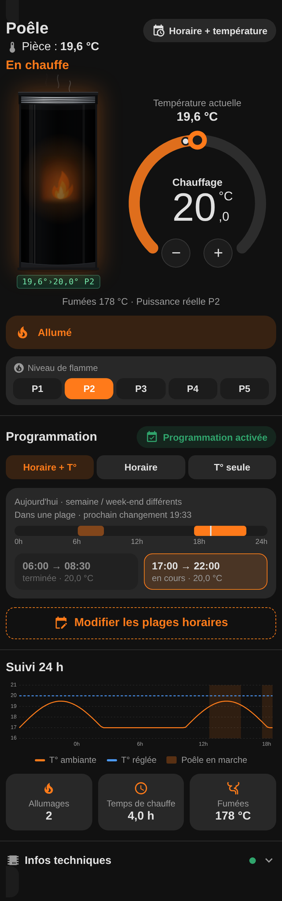
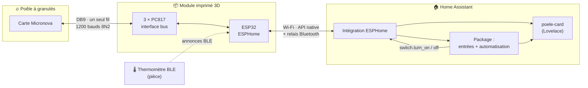
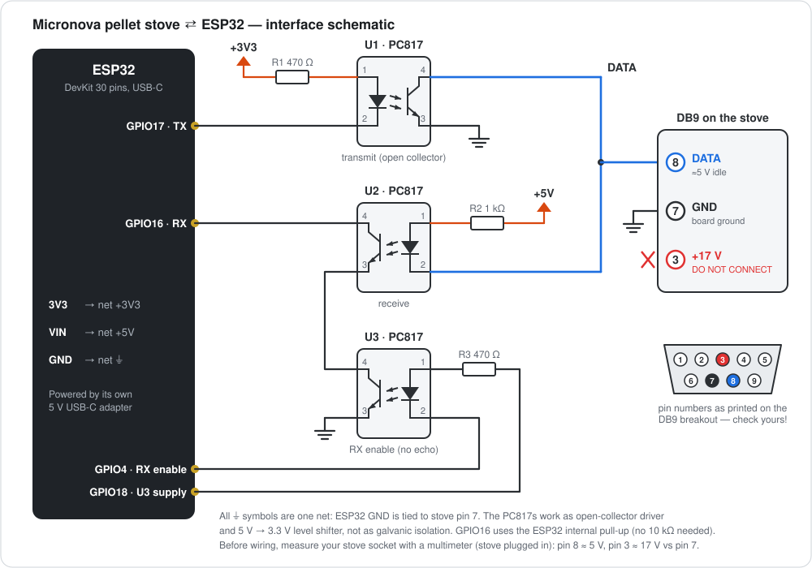
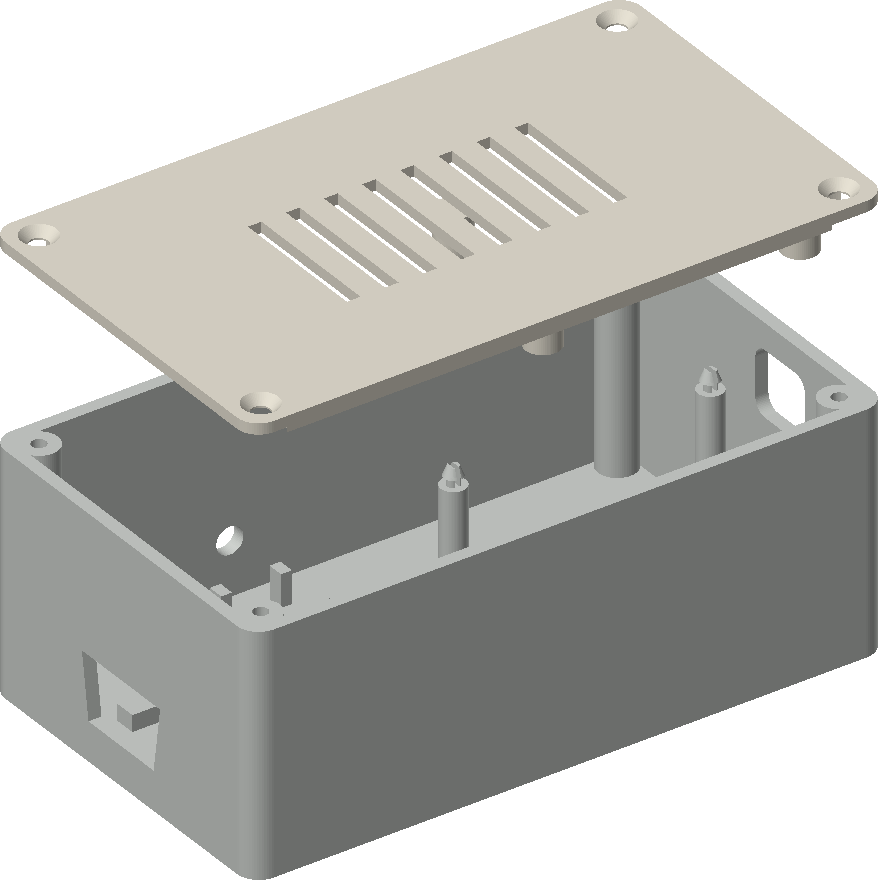
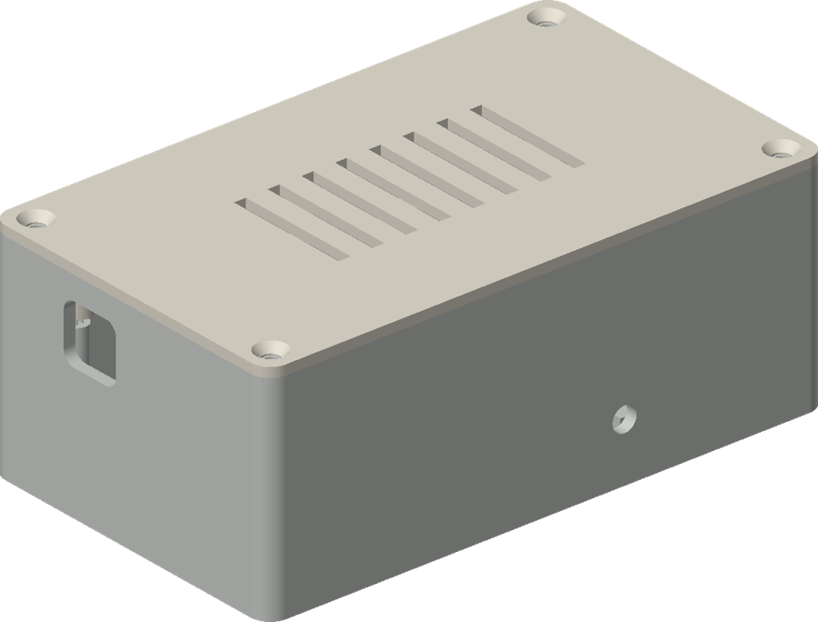
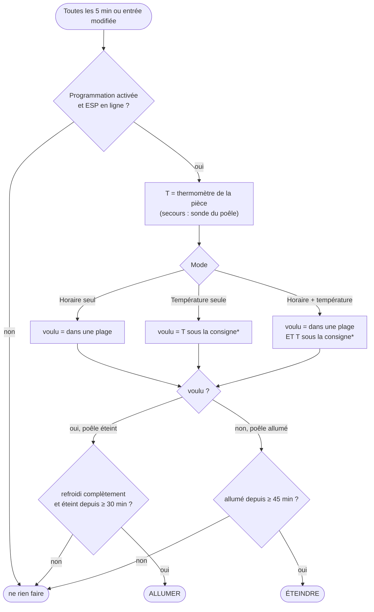

<div align="center">

# 🔥 Poêle à granulés Moretti × ESP32 × Home Assistant

**Piloter en local un poêle à carte Micronova : ESP32 + ESPHome, un vrai thermostat avec plages horaires dans Home Assistant, et une carte de tableau de bord animée.**



[](https://esphome.io/components/micronova.html)
[](https://www.home-assistant.io/)
[](LICENSE)

[🇬🇧 English](README.md) · 🇫🇷 Français

</div>

---

## Sommaire

- [Pourquoi](#pourquoi)
- [Ce que ça donne](#ce-que-ça-donne)
- [Fonctionnement](#fonctionnement)
- [Matériel](#matériel)
- [Câblage](#câblage)
- [Boîtier](#boîtier)
- [Activer la commande à distance sur le poêle](#activer-la-commande-à-distance-sur-le-poêle)
- [Firmware ESPHome](#firmware-esphome)
- [Home Assistant : thermostat et programmation](#home-assistant--thermostat-et-programmation)
- [Carte du tableau de bord](#carte-du-tableau-de-bord)
- [Thermomètre d'ambiance (Bluetooth)](#thermomètre-dambiance-bluetooth)
- [Dépannage et retours d'expérience](#dépannage-et-retours-dexpérience)
- [Organisation du dépôt](#organisation-du-dépôt)
- [Crédits et avertissement](#crédits-et-avertissement)

---

## Pourquoi

Le poêle (un **Moretti Design A7 SAT Glass**, carte Micronova) est livré avec une télécommande qui sert aussi de thermostat d'ambiance. Sa mesure était fausse de plusieurs degrés, malgré deux calibrations par le technicien, impossible de programmer quoi que ce soit de correct, et aucun moyen de voir ce que faisait le poêle depuis un téléphone.

Ce projet remplace tout ça par :

- un **ESP32** qui dialogue directement avec la carte Micronova par son bus série (prise DB9 à l'arrière du poêle) ;
- **ESPHome**, qui expose le poêle à Home Assistant (marche/arrêt, état, puissance de flamme, température des fumées…) ;
- un **package Home Assistant** qui fait de n'importe quel thermomètre le thermostat du poêle, avec plages horaires et protection anti-cycles courts ;
- une **carte Lovelace** sur mesure, avec poêle animé, cadran de consigne et historique 24 h.

La télécommande d'origine dort maintenant dans un tiroir. 🧦

> **Autres poêles :** beaucoup de poêles italiens utilisent une carte Micronova (Extraflame, La Nordica et bien d'autres). Si le tien a le même port série DB9/RJ11, l'essentiel s'applique. Les adresses mémoire peuvent varier selon les modèles : voir la [doc ESPHome micronova](https://esphome.io/components/micronova.html).

## Ce que ça donne

| Tableau de bord (en chauffe) | Tableau de bord (éteint) |
|:---:|:---:|
|  |  |

<details>
<summary>📱 Sur téléphone</summary>
<p align="center"></p>
</details>

<sub>Captures générées avec des données fictives.</sub>

- 🔌 **Contrôle local**, sans cloud ni appli constructeur : marche/arrêt, niveau de flamme P1 à P5, état en direct (allumage, chauffe, nettoyage, alarmes…).
- 🌡️ **Vrai thermostat** : consigne avec hystérésis de ±0,5 °C, basée sur n'importe quel thermomètre de Home Assistant, avec repli automatique sur la sonde du poêle.
- 🗓️ **Programmation** : « Horaire + température », « Horaire seul » ou « Température seule », plages modifiables depuis la carte.
- 🛡️ **Protections** : ne relance jamais un poêle qui n'a pas fini son refroidissement, 30 min d'arrêt et 45 min de marche minimum.
- 📶 **Relais Bluetooth** : l'ESP du poêle relaie aussi les capteurs BLE vers Home Assistant (pratique pour le thermomètre d'ambiance).
- 🎨 **Carte animée** : flamme, lueur et fumée suivent l'état réel du poêle ; état hors ligne ; retour visuel des commandes en cours.
- 🖨️ **Boîtier imprimé en 3D** avec la prise DB9 intégrée dans la paroi.

## Fonctionnement



La carte Micronova expose un **bus série half-duplex sur un seul fil** (5 V au repos). L'ESP lit et écrit la RAM/EEPROM de la carte grâce au composant ESPHome [`micronova`](https://esphome.io/components/micronova.html) :

| Sens | Quoi | Comment |
|---|---|---|
| ESP → poêle | envoi des trames | GPIO17 pilote U1, dont le transistor tire la ligne DATA à la masse |
| poêle → ESP | lecture des réponses | la LED de U2 suit la ligne DATA, son transistor tire GPIO16 à la masse |
| anti-écho | ignorer nos propres trames | GPIO4 pilote U3, en série avec U2 : la réception est coupée pendant l'émission |

Le poêle continue de faire ce qu'il sait faire (allumage, alimentation en granulés, nettoyages, sécurités). Home Assistant décide seulement **quand** il doit tourner.

## Matériel

Les liens sont de simples fiches produit amazon.fr (sans lien affilié), à titre d'exemple : n'importe quelle pièce équivalente convient.

| Pièce | Qté | Remarques |
|---|:---:|---|
| Carte ESP32, 30 broches, USB-C (WROOM-32, type « HW-394 ») | 1 | n'importe quel ESP32 DevKit convient ; le boîtier est dimensionné pour celle-ci (~53 × 29,5 mm) |
| Optocoupleur PC817 (DIP-4) | 3 | [PC817C, lot de 100](https://www.amazon.fr/dp/B0F3D13MKL) |
| Résistance 470 Ω | 2 | R1, R3 |
| Résistance 1 kΩ | 1 | R2 |
| Adaptateur DB9 **mâle** à bornier à vis | 1 | se branche directement sur la prise du poêle · [adaptateur DB9-F-8A](https://www.amazon.fr/dp/B08LYR2KDD) |
| Fils Dupont (F-F et M-F) | ~15 | ou tout souder sur plaque à trous |
| Alimentation USB-C 5 V + câble | 1 | l'ESP n'est **pas** alimenté par le poêle |
| Vis M3 × 10 tête fraisée autotaraudeuses | 4 | couvercle |
| Filament PLA ou PETG | < 100 g | |
| *Option :* thermomètre BLE reconnu par Home Assistant | 1 | celui utilisé ici : [SwitchBot Meter, lot de 3](https://www.amazon.fr/dp/B0F8HG1CXV) · un Xiaomi LYWSD03MMC marche aussi |

## Câblage

<p align="center"></p>

> [!CAUTION]
> **Mesure d'abord ton propre poêle.** Sur celui-ci, la prise DB9 donne, par rapport à la broche 7 : **broche 8 ≈ 5 V (DATA)** et **broche 3 ≈ 17 V**. Un signal branché sur le 17 V grille l'optocoupleur au mieux, l'ESP au pire. La coque du DB9 est la terre, pas la masse de la carte : n'y touche pas. Débranche le poêle du secteur avant de brancher ou débrancher la prise.

<details>
<summary>🔧 Liste des fils un par un (montage Dupont, 15 fils)</summary>

La patte 1 du PC817 est repérée par un point. Pattes : 1 = anode LED, 2 = cathode LED, 3 = émetteur, 4 = collecteur.

| # | De | Vers | Réseau |
|:-:|---|---|---|
| 1 | ESP **3V3** | R1 (470 Ω) | +3V3 |
| 2 | R1 | **U1 patte 1** | |
| 3 | ESP **GPIO17** | **U1 patte 2** | TX |
| 4 | ESP **GND** | **U1 patte 3** | GND |
| 5 | **U1 patte 4** | borne DB9 **8** | DATA |
| 6 | ESP **VIN** (5 V) | R2 (1 kΩ) | +5V |
| 7 | R2 | **U2 patte 1** | |
| 8 | **U2 patte 2** | borne DB9 **8** | DATA |
| 9 | **U2 patte 4** | ESP **GPIO16** | RX |
| 10 | **U2 patte 3** | **U3 patte 4** | |
| 11 | ESP **GPIO18** | R3 (470 Ω) | alim. U3 |
| 12 | R3 | **U3 patte 1** | |
| 13 | **U3 patte 2** | ESP **GPIO4** | activation RX |
| 14 | **U3 patte 3** | borne DB9 **7** | GND |
| 15 | ESP **GND** | borne DB9 **7** | GND |

Astuces : entoure chaque résistance et chaque PC817 de scotch d'électricien une fois branchés, pour qu'aucune patte nue ne se touche. Deux fils partagent la borne 8 et deux la borne 7 : serre fort, puis tire doucement sur chaque fil.

</details>

**Variantes**

- R3 peut aller sur le **3V3** au lieu de GPIO18 (U3 alors toujours alimenté). Supprime dans ce cas le switch `u3_supply` du YAML.
- Une résistance de tirage de 10 kΩ entre GPIO16 et 3V3 est facultative : le pull-up interne de l'ESP32 est activé dans la config.

## Boîtier

| Vue éclatée | Fermé (côté USB-C) |
|:---:|:---:|
|  |  |

Fichiers dans [`hardware/enclosure/`](hardware/enclosure/) :

- `enclosure_v3_box.stl`, `enclosure_v3_lid.stl` : prêts à imprimer, sans supports (couches 0,2 mm, 3 périmètres, remplissage 20 %).
- `enclosure_v3.py` : source paramétrique (Python + [manifold3d](https://github.com/elalish/manifold)). `pip install manifold3d trimesh numpy && python enclosure_v3.py`.

Conception : l'adaptateur DB9 est encastré dans une paroi (prise dehors, borniers dedans), l'ouverture USB-C est sur la paroi opposée, l'ESP se clipse sur 4 tétons broches vers le bas, le couvercle tient avec 4 vis M3. Encombrement 117 × 69 × 46 mm.

> [!NOTE]
> Les STL sont en **v3.1**, c'est-à-dire la v3 imprimée plus deux corrections apprises au montage : la découpe DB9 est agrandie de 0,5 mm (la v3 a dû être reprise au cutter) et les trous des colonnettes du DB9 ont disparu. Les colonnettes doivent rester sur l'adaptateur pour le visser sur le poêle, donc on **colle** la bride de l'adaptateur à l'intérieur de la paroi (colle rapide ou époxy). Les deux réglages sont en tête du script. La v3.1 elle-même n'a pas encore été réimprimée.

**Le PLA suffit :** sur ce poêle, l'arrière (là où se trouve la prise DB9) reste à la température de la pièce. Si l'arrière de ton poêle chauffe, imprime plutôt en PETG ou en ASA (le PLA ramollit vers 55 °C).

## Activer la commande à distance sur le poêle

> [!IMPORTANT]
> **À faire en premier.** D'usine, la carte Micronova ignore les ordres qui arrivent par son port série. Tant que l'activation à distance est désactivée, l'ESP ne peut pas piloter le poêle, même avec un câblage parfait.

Le réglage se trouve dans le **menu technicien** caché du poêle, accessible depuis la télécommande d'origine.

1. Sur la télécommande, ouvre le menu système / technicien : il demande un code d'accès (un champ `00`).
2. Saisis le code. Sur les poêles **Moretti Design**, c'est **`M0`** (la lettre M puis le chiffre zéro ; `MO` sur certains modèles). Les flèches font défiler les chiffres, puis les lettres. Valide avec **OK**. Les autres marques ont d'autres codes : demande à ton installateur ou au fabricant.
3. Le menu affiche des entrées comme *TYPE PELLET, RÉGLAGE USINE, SETTING GÉNÉRAL, TEST SORTIE, EFFACER ALARME, BANQUE DONNÉE…*
4. Ouvre les sous-menus *RÉGLAGE USINE* / *SETTING GÉNÉRAL*. Attention, dans ces sous-menus **OK passe au paramètre suivant, les flèches changent la valeur**. Fais défiler avec OK jusqu'à **ACTIVATION À DISTANCE** (paramètre *Pr46* dans les manuels Micronova).
5. Passe-le sur **ON** avec une flèche, valide avec **OK**, puis ressors du menu sans toucher à rien d'autre.
6. Éteins le poêle avec l'interrupteur à l'arrière, attends 10 secondes et rallume-le pour que la carte recharge ses réglages.

> [!WARNING]
> Tous les autres paramètres de ce menu pilotent la combustion. **Prends chaque écran en photo avant de modifier quoi que ce soit**, ne change que l'activation à distance, et n'entre jamais dans *TEST SORTIE* (il actionne les moteurs), *EFFACER…* ni *BANQUE DONNÉE* (qui peut recharger les paramètres d'usine). Modifier les réglages technicien peut faire sauter la garantie.

## Firmware ESPHome

1. Dans le tableau de bord ESPHome, crée un nouvel appareil et colle [`esphome/pellet-stove.yaml`](esphome/pellet-stove.yaml).
2. Ajoute les clés manquantes dans ton `secrets.yaml` ESPHome (modèle : [`esphome/secrets.example.yaml`](esphome/secrets.example.yaml)).
3. Flashe en USB **avant** de brancher le poêle. Les mises à jour suivantes passent en Wi-Fi.
4. Poêle débranché du secteur : branche le module sur la prise DB9, puis rebranche le poêle.
5. Regarde les logs : l'état et les températures doivent afficher des valeurs cohérentes. **Ne touche pas au bouton marche/arrêt tant que la lecture ne marche pas.**
6. Home Assistant découvre l'appareil : accepte-le dans *Paramètres → Appareils et services*.

Garde `name: poele`, sinon adapte les entités dans le package et la carte. Entités obtenues :

| Entité | Rôle |
|---|---|
| `switch.poele_poele` | marche/arrêt |
| `sensor.poele_etat` | état (en français grâce au filtre `map`) |
| `number.poele_niveau_de_flamme` | niveau de flamme 1 à 5 |
| `sensor.poele_puissance` | puissance réelle |
| `sensor.poele_temperature_fumees` | température des fumées |
| `sensor.poele_temperature_ambiante` | température lue par le poêle (secours uniquement) |
| `sensor.poele_signal_wifi`, `sensor.poele_adresse_ip`, `sensor.poele_version_esphome`, `sensor.poele_dernier_redemarrage_esp` | diagnostic |

À propos de la config :

- **Température des fumées** lue en `0x00:0x58` sur ce poêle (vérifié à chaud et à froid). Ton modèle peut différer.
- **Interrogations volontairement espacées** (60 à 300 s) : si la télécommande d'origine sert encore, chaque trame risque une collision.
- **Relais Bluetooth** : facultatif ; il impose de retirer `power_save_mode: none` (Wi-Fi et BLE partagent la radio).

## Home Assistant : thermostat et programmation

[`homeassistant/packages/pellet_stove.yaml`](homeassistant/packages/pellet_stove.yaml) crée tout en un seul fichier :

| Entrée | Rôle |
|---|---|
| `input_boolean.poele_programmation` | interrupteur général de l'automatisation |
| `input_number.poele_consigne` | consigne, 15 à 25 °C, pas de 0,5 |
| `input_select.poele_mode_programmation` | `Horaire + température` / `Horaire seul` / `Température seule` |
| `schedule.poele_plages_horaires` | plages hebdomadaires (le fichier contient des plages d'exemple) |
| `automation.poele_programmation` | la logique ci-dessous |

**Installation :** active les packages dans `configuration.yaml`, copie le fichier, puis remplace `sensor.room_temperature` par ton thermomètre :

```yaml
homeassistant:
  packages: !include_dir_named packages
```

**Logique de décision** (toutes les 5 min et à chaque changement d'une entrée) :



<sub>* hystérésis : en marche, on chauffe jusqu'à consigne + 0,5 °C ; à l'arrêt, on relance sous consigne − 0,5 °C. Une mesure ≤ 3 °C est considérée invalide ; le mode « Horaire + température » se replie alors sur l'horaire seul.</sub>

Entre ces décisions marche/arrêt, le poêle module lui-même sa puissance (niveau de flamme réglable depuis la carte).

## Carte du tableau de bord

[`lovelace/poele-card.js`](lovelace/poele-card.js), un seul fichier sans dépendance.

1. Copie-le dans `<config>/www/poele-card.js`.
2. *Paramètres → Tableaux de bord → ⋮ → Ressources → Ajouter* : `/local/poele-card.js`, type **Module JavaScript**. Ajoute `?v=2` à la fin de l'URL après chaque mise à jour pour contourner le cache.
3. Ajoute une carte en mode YAML :

```yaml
type: custom:poele-card
room: sensor.ton_thermometre   # en général la seule option nécessaire
```

Dans un tableau de bord en *sections*, donne toute la largeur à sa section (la carte la demande). Toutes les options, avec leurs valeurs par défaut :

| Option | Défaut |
|---|---|
| `title` | `Poêle` |
| `room` | `sensor.room_temperature` |
| `room_remote` | `sensor.poele_temperature_ambiante` |
| `switch` | `switch.poele_poele` |
| `state` | `sensor.poele_etat` |
| `setpoint` | `input_number.poele_consigne` |
| `flame` | `number.poele_niveau_de_flamme` |
| `power` | `sensor.poele_puissance` |
| `fumes` | `sensor.poele_temperature_fumees` |
| `prog` / `mode` / `schedule` / `automation` | les entrées du package |
| `wifi` / `ip` / `uptime` / `version` | diagnostic de l'ESP |

Ce qu'elle affiche : l'illustration du poêle (flamme, lueur et fumée suivent l'état réel, grisée à l'arrêt), la température de la pièce, un cadran de consigne, marche/arrêt avec confirmation, le niveau de flamme P1 à P5, les plages du jour avec le prochain changement et un éditeur intégré, un graphique 24 h (température, consigne, périodes de marche), les allumages et le temps de chauffe sur 24 h, la température des fumées, et un panneau de diagnostic repliable. Quand l'ESP est hors ligne, les commandes sont désactivées et une notification explique pourquoi une commande a échoué.

## Thermomètre d'ambiance (Bluetooth)

N'importe quelle entité de température convient. Un thermomètre BLE bon marché est parfait, et l'ESP du poêle est déjà un **relais Bluetooth** : il transmet le capteur même si le serveur Home Assistant est loin.

- SwitchBot Meter / Outdoor Meter : l'intégration **SwitchBot Bluetooth** intégrée le lit en local. **Pas de compte SwitchBot, pas de hub, pas de cloud.**
- Place-le dans la pièce, à hauteur d'homme, loin du rayonnement du poêle et des fenêtres.
- Un poêle est une grosse boîte en acier qui bloque le 2,4 GHz. Si le signal est faible (autour de −90 dBm), mets le thermomètre en vue directe de l'ESP.

## Dépannage et retours d'expérience

<details>
<summary><b>Le poêle ne répond jamais</b></summary>

Vérifie que **ACTIVATION À DISTANCE** est sur ON dans le menu technicien ([voir plus haut](#activer-la-commande-à-distance-sur-le-poêle)), et que DATA est bien sur la broche mesurée à ≈ 5 V.
</details>

<details>
<summary><b>ESP en ligne mais poêle « indisponible », ou commandes ignorées</b></summary>

Neuf fois sur dix : la prise DB9 n'est pas enfoncée à fond. Une paroi imprimée un peu épaisse ou un reste de colle suffit à la retenir d'un millimètre. Recoupe, renfonce, vérifie les logs.
</details>

<details>
<summary><b>Le bouton marche revient sur « éteint »</b></summary>

L'écriture n'est pas arrivée au poêle (mauvais contact, ou collision avec la télécommande). Regarde les trames et réponses dans les logs ESPHome. Une fois la télécommande retirée, les écritures passent du premier coup.
</details>

<details>
<summary><b>La température ambiante du poêle affiche 0,0</b></summary>

Sur ce poêle, la RAM `0x01` (température ambiante) vient de la sonde de la télécommande. Sans télécommande, elle vaut 0. C'est pour ça que le package et la carte utilisent un thermomètre externe et ignorent toute valeur ≤ 3 °C.
</details>

<details>
<summary><b>Garder ou retirer la télécommande d'origine</b></summary>

La télécommande parle sur le même bus. Les deux peuvent cohabiter (d'où les interrogations espacées), mais les collisions arrivent. Avec un thermomètre externe, Home Assistant fait tout ce que faisait la télécommande, en mieux : lui retirer ses piles a nettement fiabilisé le bus.
</details>

<details>
<summary><b>ESPHome refuse de compiler avec bluetooth_proxy</b></summary>

Retire `power_save_mode: none` du bloc `wifi:`. La cohabitation Wi-Fi/BLE impose le mode d'économie par défaut.
</details>

<details>
<summary><b>Boîtier : impossible de visser l'adaptateur DB9 à travers la paroi</b></summary>

Si tu visses les colonnettes de l'adaptateur à travers la paroi depuis l'extérieur, il ne reste plus rien pour le visser sur la prise du poêle. Colle plutôt la bride à l'intérieur (c'est ce que fait la v3.1).
</details>

## Organisation du dépôt

```
.
├── esphome/
│   ├── pellet-stove.yaml          config ESPHome (micronova + relais BLE)
│   └── secrets.example.yaml
├── homeassistant/packages/
│   └── pellet_stove.yaml          entrées + plages + automatisation thermostat
├── lovelace/
│   └── poele-card.js              carte de tableau de bord
├── hardware/enclosure/
│   ├── enclosure_v3.py            boîtier paramétrique (Python / manifold3d)
│   ├── enclosure_v3_box.stl
│   └── enclosure_v3_lid.stl
└── docs/
    ├── wiring.svg
    └── img/
```

## Crédits et avertissement

- [Composant ESPHome `micronova`](https://esphome.io/components/micronova.html) et la communauté qui a décodé le protocole Micronova ; l'interface à 3 optocoupleurs est le montage classique de ces projets.
- Construit pas à pas avec Claude (Anthropic).

> [!WARNING]
> Un poêle à granulés est un appareil à combustion. Ce projet n'utilise que les commandes du poêle lui-même (les mêmes que la télécommande) : allumage, extinction, nettoyages et toutes les sécurités restent gérés par la carte Micronova. Ne laisse jamais tourner un poêle d'une façon que tu n'accepterais pas avec sa télécommande d'origine.

### Responsabilité

Ce projet est partagé à titre informatif et pédagogique, **en l'état, sans aucune garantie**. En le reproduisant, tu acceptes que :

- tu ouvres, câbles et modifies ton appareil **entièrement à tes risques et sous ta seule responsabilité** ;
- l'auteur **ne peut être tenu responsable** d'aucun dommage, direct ou indirect : à ton poêle, à sa carte électronique, à ton installation électrique, à ton logement ou à tout autre bien, ni d'aucune blessure, incendie, panne, perte de garantie ou perte du support constructeur ;
- c'est à toi de vérifier le brochage, les tensions et les réglages de **ton propre** poêle, et de respecter les consignes du fabricant et la réglementation en vigueur chez toi ;
- si tu n'es pas à l'aise avec l'électronique ou avec le menu technicien de ton poêle, fais appel à un professionnel qualifié.

Publié sous [licence MIT](LICENSE).
