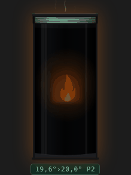
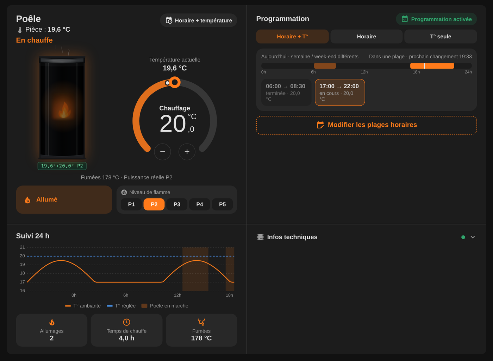
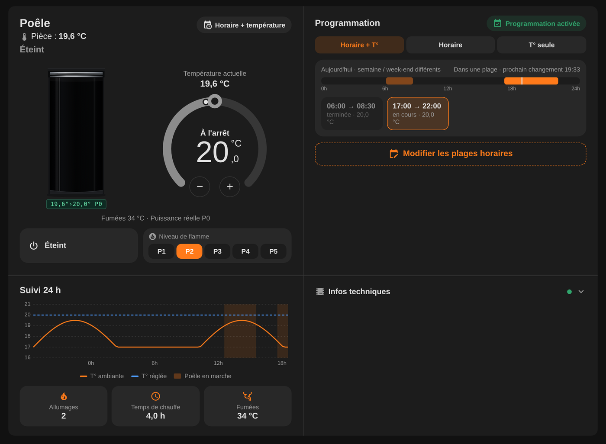
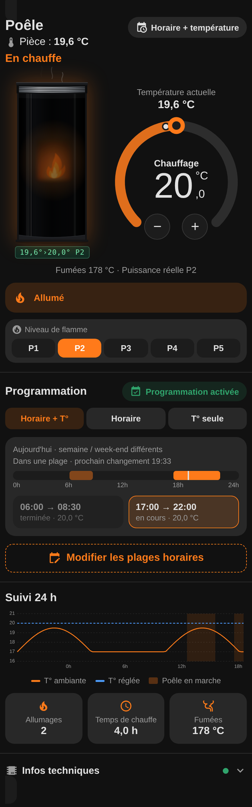
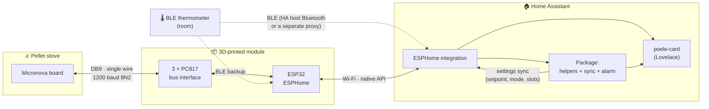
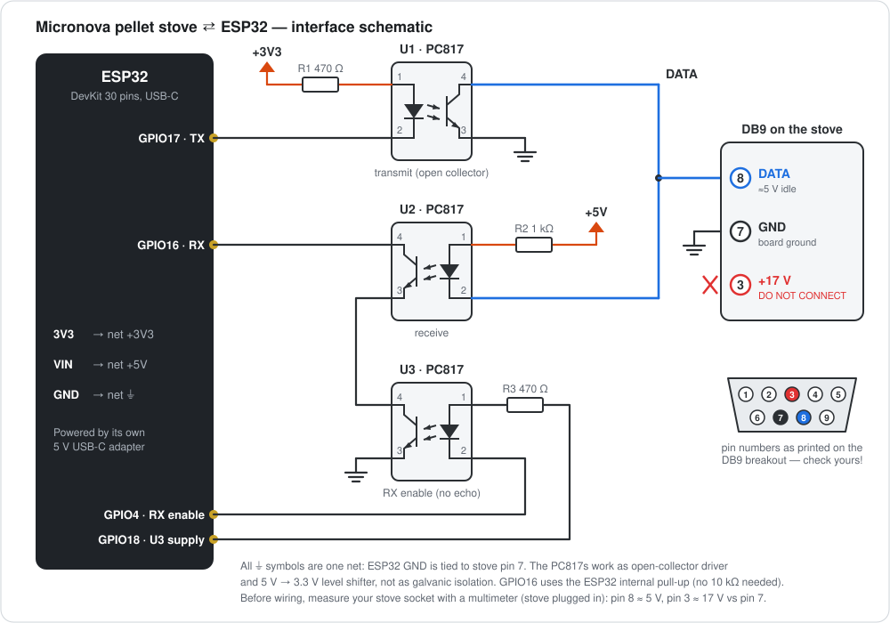
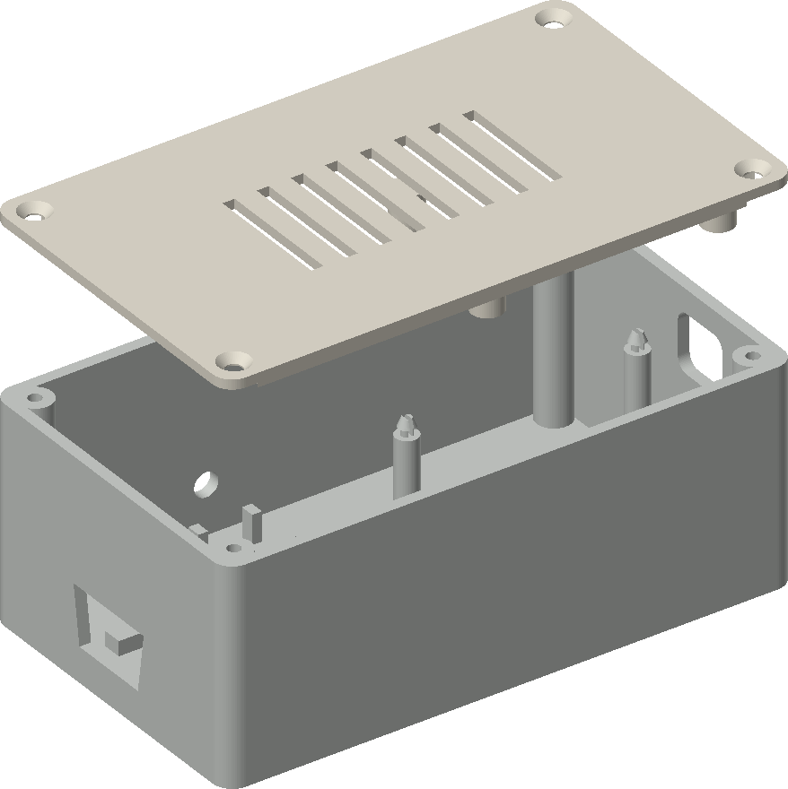
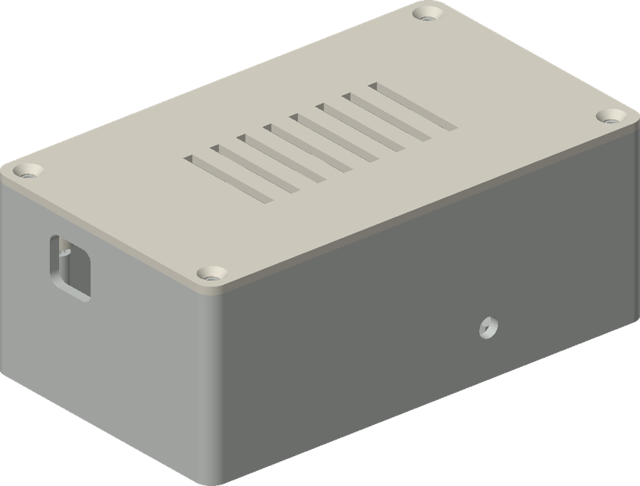
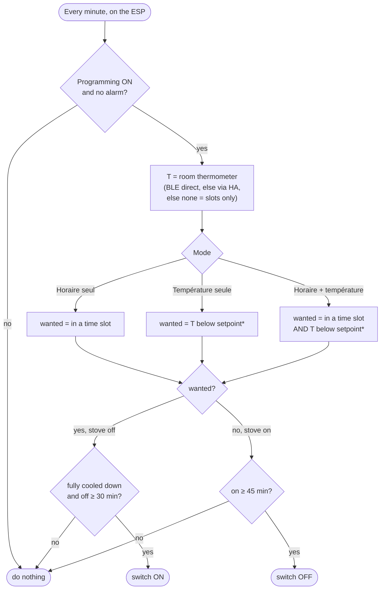
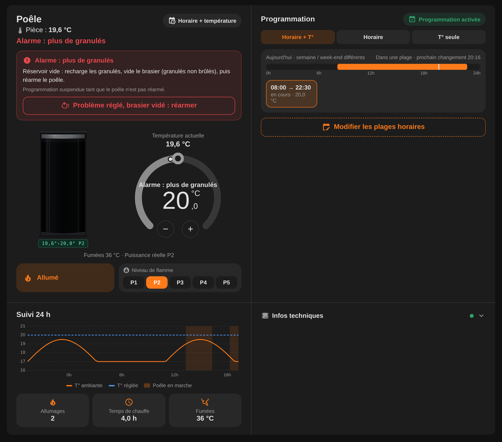

<div align="center">

# 🔥 Moretti pellet stove × ESP32 × Home Assistant

**Take local control of a Micronova-based pellet stove: ESP32 + ESPHome, a real thermostat with schedules in Home Assistant, and a custom animated dashboard card.**



[](https://esphome.io/components/micronova.html)
[](https://www.home-assistant.io/)
[](LICENSE)

🇬🇧 English · [🇫🇷 Français](README.fr.md)

</div>

> [!TIP]
> The official Wi-Fi module costs [more than €230](https://www.lacentraledupoele.com/produit/17253-systeme-wifi-navel-micronova-moretti-design) (without installation) and relies on a proprietary app [rated 2.1/5](https://play.google.com/store/apps/details?id=com.micronovasrl.ninamoretti). This project does better, locally, for about €20 of parts.

---

## Table of contents

- [Why](#why)
- [What you get](#what-you-get)
- [How it works](#how-it-works)
- [Bill of materials](#bill-of-materials)
- [Wiring](#wiring)
- [Enclosure](#enclosure)
- [Enable remote control on the stove](#enable-remote-control-on-the-stove)
- [ESPHome firmware](#esphome-firmware)
- [Home Assistant: thermostat & schedule](#home-assistant-thermostat--schedule)
- [Dashboard card](#dashboard-card)
- [Room thermometer (Bluetooth)](#room-thermometer-bluetooth)
- [Troubleshooting & lessons learned](#troubleshooting--lessons-learned)
- [Repository layout](#repository-layout)
- [Credits & disclaimer](#credits--disclaimer)

---

## Why

The stove (a **Moretti Design A7 SAT Glass**, Micronova controller board) came with a remote control that also acts as the room thermostat. Its temperature reading was off by several degrees, even after two technician calibrations, and there was no way to schedule anything sensible or to see what the stove was doing from a phone.

This project replaces all of that with:

- an **ESP32** talking directly to the Micronova board over its serial bus (DB9 socket at the back of the stove);
- **ESPHome** exposing the stove to Home Assistant (on/off, state, flame power, fumes temperature…);
- a **Home Assistant package** that turns any thermometer into the stove thermostat, with time slots and anti short-cycle protection;
- a **custom Lovelace card** with an animated stove, a dial thermostat and a 24 h history.

The original remote now lives in a drawer. 🧦

> **Other stoves:** many Italian pellet stoves use a Micronova board (Extraflame, La Nordica and many others). If yours has the same DB9/RJ11 serial port, most of this applies. Memory addresses can differ between models: check the [ESPHome micronova docs](https://esphome.io/components/micronova.html).

## What you get

| Dashboard (stove heating) | Dashboard (stove off) |
|:---:|:---:|
|  |  |

<details>
<summary>📱 Phone layout</summary>
<p align="center"></p>
</details>

<sub>Screenshots rendered with fake data. The card UI is in French.</sub>

- 🔌 **Local control**, no cloud, no vendor app: on/off, flame level P1–P5, live state (ignition, heating, cleaning, alarms…).
- 📱 **From anywhere**: with remote access to Home Assistant (Home Assistant Cloud, a VPN or your own reverse proxy), light the stove on your way home when it's cold, and come back to a warm house.
- 🧠 **Autonomous**: the schedule and thermostat run **on the ESP**. If Wi-Fi or Home Assistant goes down, the stove keeps following the last settings it received. Home Assistant is the remote control.
- 🌡️ **Real thermostat with modulation**: starts below the setpoint, drops to the lowest flame once it's reached, switches off at setpoint + 1 °C, using your room thermometer (via Home Assistant, or read directly by the ESP over Bluetooth as a backup).
- 🗓️ **Schedules**: "time slots + temperature", "time slots only" or "temperature only", editable from the card.
- 🛡️ **Protections**: never restarts a stove that hasn't finished its cooling cycle, minimum 30 min off / 45 min on.
- 🚨 **Alarm handling**: when the stove reports an alarm (no pellets, ignition failure…), the card shows the cause and what to do in plain words, Home Assistant notifies you, and the schedule is locked until you re-arm, so it never reloads pellets on top of unburnt ones.
- 🎨 **Animated card**: flame, glow and smoke follow the real stove state; offline state; pending-command feedback.
- 🖨️ **3D-printed enclosure** with the DB9 connector built into the wall.

## How it works



The Micronova board exposes a **half-duplex, single-wire serial bus** (5 V idle). The ESP reads and writes the board's RAM/EEPROM through the ESPHome [`micronova`](https://esphome.io/components/micronova.html) component:

| Direction | What | How |
|---|---|---|
| ESP → stove | send frames | GPIO17 drives U1, whose transistor pulls the DATA line low |
| stove → ESP | read replies | U2's LED follows the DATA line, its transistor pulls GPIO16 low |
| echo cancel | ignore our own frames | GPIO4 drives U3, in series with U2: RX is cut while the ESP transmits |

The stove keeps doing what it does best (ignition, pellet feeding, cleaning cycles, safety). The ESP only decides **when** it should run, from the settings Home Assistant gives it.

## Bill of materials

Links are plain product pages on amazon.fr (no affiliate tag), given as examples: any equivalent part works.

| Part | Qty | Notes |
|---|:---:|---|
| ESP32 dev board, 30 pins, USB-C (WROOM-32, "HW-394" type) | 1 | any ESP32 DevKit works; the enclosure is sized for this one (~53 × 29.5 mm) |
| PC817 optocoupler (DIP-4) | 3 | [PC817C, pack of 100](https://www.amazon.fr/dp/B0F3D13MKL) |
| Resistor 470 Ω | 2 | R1, R3 |
| Resistor 1 kΩ | 1 | R2 |
| DB9 **male** breakout with screw terminals | 1 | plugs straight into the stove socket · [DB9-F-8A breakout](https://www.amazon.fr/dp/B08LYR2KDD) |
| Dupont jumpers (F-F and M-F) | ~15 | or solder everything on a perfboard |
| 5 V USB-C power supply + cable | 1 | the ESP is **not** powered by the stove |
| M3 × 10 countersunk self-tapping screws | 4 | enclosure lid |
| PLA or PETG filament | < 100 g | |
| *Optional:* BLE thermometer supported by Home Assistant | 1 | the one used here: [SwitchBot Meter, pack of 3](https://www.amazon.fr/dp/B0F8HG1CXV) · Xiaomi LYWSD03MMC also works |

## Wiring

<p align="center"></p>

> [!CAUTION]
> **Measure your own stove first.** On this stove the DB9 socket gave, against pin 7: **pin 8 ≈ 5 V (DATA)** and **pin 3 ≈ 17 V**. Connecting a signal to the 17 V pin will destroy the optocoupler at best, the ESP at worst. The DB9 shell is earth, not the board ground: leave it alone. Unplug the stove from mains before plugging/unplugging the connector.

<details>
<summary>🔧 Point-to-point wire list (Dupont build, 15 wires)</summary>

PC817 pin 1 is marked with a dot. Pins: 1 = LED anode, 2 = LED cathode, 3 = emitter, 4 = collector.

| # | From | To | Net |
|:-:|---|---|---|
| 1 | ESP **3V3** | R1 (470 Ω) | +3V3 |
| 2 | R1 | **U1 pin 1** | |
| 3 | ESP **GPIO17** | **U1 pin 2** | TX |
| 4 | ESP **GND** | **U1 pin 3** | GND |
| 5 | **U1 pin 4** | DB9 terminal **8** | DATA |
| 6 | ESP **VIN** (5 V) | R2 (1 kΩ) | +5V |
| 7 | R2 | **U2 pin 1** | |
| 8 | **U2 pin 2** | DB9 terminal **8** | DATA |
| 9 | **U2 pin 4** | ESP **GPIO16** | RX |
| 10 | **U2 pin 3** | **U3 pin 4** | |
| 11 | ESP **GPIO18** | R3 (470 Ω) | U3 supply |
| 12 | R3 | **U3 pin 1** | |
| 13 | **U3 pin 2** | ESP **GPIO4** | RX enable |
| 14 | **U3 pin 3** | DB9 terminal **7** | GND |
| 15 | ESP **GND** | DB9 terminal **7** | GND |

Tips: wrap each resistor and PC817 in electrical tape once plugged in, so bare legs can't touch. Two wires share terminal 8 and two share terminal 7: tighten hard and give each wire a gentle pull.

</details>

**Variants**

- R3 can go to **3V3** instead of GPIO18 (U3 then always powered). Delete the `u3_supply` switch from the YAML.
- A 10 kΩ pull-up from GPIO16 to 3V3 is optional: the ESP32 internal pull-up is enabled in the config.

## Enclosure

| Exploded | Closed (USB-C side) |
|:---:|:---:|
|  |  |

Files in [`hardware/enclosure/`](hardware/enclosure/):

- `enclosure_v3_box.stl`, `enclosure_v3_lid.stl`: ready to print, no supports (0.2 mm layers, 3 walls, 20 % infill).
- `enclosure_v3.py`: parametric source (Python + [manifold3d](https://github.com/elalish/manifold)). `pip install manifold3d trimesh numpy && python enclosure_v3.py`.

Design: the DB9 breakout is flush-mounted in one wall (plug outside, screw terminals inside), USB-C opening on the opposite wall, the ESP clips onto 4 snap pegs with its pins facing down, 4 × M3 screws close the lid. Outer size 117 × 69 × 46 mm.

> [!NOTE]
> The STLs are **v3.1** = the printed v3 plus two fixes learned during assembly: the DB9 cut-out is 0.5 mm larger (v3 needed a cutter), and the holes for the DB9 hex standoffs are gone. The standoffs have to stay on the breakout to screw it onto the stove, so the breakout flange is **glued** inside the wall (fast glue or epoxy). Both are parameters at the top of the script. v3.1 itself has not been reprinted yet.

**PLA is fine here:** on this stove the back panel (where the DB9 socket is) stays at room temperature. If the back of your stove gets warm, print in PETG or ASA instead (PLA softens around 55 °C).

## Enable remote control on the stove

> [!IMPORTANT]
> **Do this first.** Out of the box, the Micronova board ignores commands coming from its serial port. As long as remote activation is off, the ESP can't control the stove, however good the wiring is.

The setting lives in the stove's hidden **technician menu**, reached from the original remote (the menu labels below are the French ones shown on this remote).

1. On the remote, open the system / technician menu: it asks for an access code (a `00` field).
2. Enter the code. On **Moretti Design** stoves it is **`M0`** (letter M, then the number zero; `MO` on some models). The arrows scroll the field through the numbers, then the letters. Confirm with **OK**. Other brands use other codes: ask your installer or the manufacturer.
3. The menu lists entries such as *TYPE PELLET, RÉGLAGE USINE, SETTING GÉNÉRAL, TEST SORTIE, EFFACER ALARME, BANQUE DONNÉE…*
4. Open the sub-menus *RÉGLAGE USINE* / *SETTING GÉNÉRAL*. Careful, in these sub-menus **OK moves to the next parameter, the arrows change the value**. Scroll with OK until you reach **ACTIVATION À DISTANCE** (remote activation, parameter *Pr46* in Micronova manuals).
5. Set it to **ON** with an arrow, confirm with **OK**, then leave the menu without touching anything else.
6. Switch the stove off with the switch at the back, wait 10 seconds, switch it back on so the board reloads its settings.

> [!WARNING]
> Every other parameter of this menu drives combustion. **Take a photo of each screen before changing anything**, change only remote activation, and never enter *TEST SORTIE* (it runs the motors), *EFFACER…* or *BANQUE DONNÉE* (it can reload the factory parameters). Changing technician settings may void your warranty.

## ESPHome firmware

1. In the ESPHome dashboard, create a new device and paste [`esphome/pellet-stove.yaml`](esphome/pellet-stove.yaml).
2. Add the missing keys to your ESPHome `secrets.yaml` (template: [`esphome/secrets.example.yaml`](esphome/secrets.example.yaml)).
3. Flash over USB **before** connecting the stove. Later updates go over Wi-Fi.
4. Stove unplugged from mains: plug the module into the DB9 socket, then power the stove again.
5. Check the logs: the state and temperatures should show plausible values. **Don't touch the on/off switch until reads work.**
6. Home Assistant discovers the device: accept it in *Settings → Devices & services*.

Keep `name: poele`, or adapt the entity IDs in the package and the card. The entities you get:

| Entity | Meaning |
|---|---|
| `switch.poele_poele` | stove on/off |
| `sensor.poele_etat` | state (French by default, English if you remove the `map` filter) |
| `number.poele_niveau_de_flamme` | flame power level 1–5 |
| `sensor.poele_puissance` | actual power level |
| `sensor.poele_temperature_fumees` | fumes temperature |
| `sensor.poele_temperature_ambiante` | stove's own room temperature (fallback only) |
| `sensor.poele_signal_wifi`, `sensor.poele_adresse_ip`, `sensor.poele_version_esphome`, `sensor.poele_dernier_redemarrage_esp` | diagnostics |

Notes on the config:

- **Fumes temperature** is read at `0x00:0x58` on this stove (checked hot and cold). Your model may differ.
- **Polling is slow on purpose** (60–300 s): if the original remote is still used, each frame can collide with it.
- **Substitutions at the top**: your room thermometer entity in Home Assistant, and optionally the MAC of a SwitchBot Meter the ESP reads directly over Bluetooth (low-duty passive scan, no proxy).
- **No fallback hotspot**: with `ap:` + `captive_portal`, a Wi-Fi drop made the ESP switch to its own hotspot and barely try to reconnect; removed.
- **New entities**: `text.poele_plages_<day>`, `number.poele_consigne_esp`, `select.poele_mode_esp`, `switch.poele_programmation_esp` (filled by the package), `sensor.poele_decision_programmation` (what the ESP decides and why), `button.poele_rearmer`, `binary_sensor.poele_alarme_a_traiter_esp`, `number.poele_puissance_de_chauffe_esp` (normal flame level).
- **Diagnostics**: free memory, loop time and the cause of the last reboot (power loss, crash, watchdog…) are exposed as sensors.

## Home Assistant: thermostat & schedule

[`homeassistant/packages/pellet_stove.yaml`](homeassistant/packages/pellet_stove.yaml) creates everything in one file:

| Helper | Role |
|---|---|
| `input_boolean.poele_programmation` | schedule on/off |
| `input_number.poele_consigne` | setpoint, 15–25 °C, 0.5 steps |
| `input_select.poele_mode_programmation` | `Horaire + température` / `Horaire seul` / `Température seule` |
| `schedule.poele_plages_horaires` | weekly time slots (the file ships example slots) |
| `automation.poele_synchro_esp` | copies all of the above into the ESP: on every change, every 15 min and when the ESP reconnects |
| `automation.poele_alarme` + `input_boolean.poele_alarme_a_traiter` + `input_text.poele_cause_alarme` | alarm: cause + advice, notification (the ESP locks its schedule by itself) |
| `script.poele_rearmer` | re-arm after an alarm: clears it on the stove and unlocks the schedule |

**Install:** enable packages in `configuration.yaml` and copy the file:

```yaml
homeassistant:
  packages: !include_dir_named packages
```

**Decision logic**, running **on the ESP** every minute, with or without Home Assistant:



<sub>* start below the setpoint; while running, keep heating up to setpoint + 1 °C. Without a valid temperature (none received, or HA unreachable for over 30 min), "time slots + temperature" falls back to time slots only. On/off timers live in the ESP, so reconnections can't reset them.</sub>

**Flame modulation** while it runs ("En chauffe"):

| Room temperature | Flame |
|---|---|
| below the setpoint | `number.poele_puissance_de_chauffe_esp` (your normal level, 1–5) |
| from the setpoint to setpoint + 1 °C | 1 (minimum) |
| setpoint + 1 °C or more | switched off (after the 45 min minimum) |

It goes back to the normal level below setpoint − 0.2 °C, so it doesn't change power at every tenth of a degree. In "Horaire seul" mode, or without a temperature, the flame stays at the normal level.

## Dashboard card

[`lovelace/poele-card.js`](lovelace/poele-card.js), a single file with no dependencies.

1. Copy it to `<config>/www/poele-card.js`.
2. *Settings → Dashboards → ⋮ → Resources → Add*: `/local/poele-card.js`, type **JavaScript module**. Bump `?v=2` at the end of the URL after each update to bypass caches.
3. Add a card in YAML mode:

```yaml
type: custom:poele-card
room: sensor.your_room_thermometer   # the only option you usually need
```

In a *sections* dashboard, give its section the full width (the card asks for it). All options, with their defaults:

| Option | Default |
|---|---|
| `title` | `Poêle` |
| `room` | `sensor.room_temperature` |
| `room_remote` | `sensor.poele_temperature_ambiante` |
| `switch` | `switch.poele_poele` |
| `state` | `sensor.poele_etat` |
| `setpoint` | `input_number.poele_consigne` |
| `flame` | `number.poele_niveau_de_flamme` |
| `power` | `sensor.poele_puissance` |
| `fumes` | `sensor.poele_temperature_fumees` |
| `prog` / `mode` / `schedule` / `automation` | the package helpers |
| `wifi` / `ip` / `uptime` / `version` | ESP diagnostics |
| `alarm_lock` / `alarm_cause` / `rearm` | the package's alarm helpers and re-arm script |
| `decision` | `sensor.poele_decision_programmation`, shown in the diagnostics panel |
| `sync` | `automation.poele_synchro_esp`, triggered right after you save the time slots |

What it shows: the stove illustration (flame, glow and smoke follow the actual state, grey when off), the current room temperature, a dial for the setpoint, on/off with confirmation, flame level P1–P5, today's time slots with the next change and an in-place editor, a 24 h graph (room temperature, setpoint, running periods), ignitions and heating time over 24 h, fumes temperature, and a collapsible diagnostics panel. When the ESP is offline, controls are disabled and a notification explains why a command failed.

**In alarm**, a red box gives the cause and what to do, with a *re-arm* button (two taps) once the brazier is emptied:

<p align="center"></p>

## Room thermometer (Bluetooth)

Any temperature entity works. A cheap BLE thermometer is perfect, received by your Home Assistant host's Bluetooth. The stove ESP can also read a SwitchBot Meter **directly** (set its MAC in the substitutions): that's the backup used when Home Assistant is unreachable, as long as the thermometer is within a few metres of the ESP.

- SwitchBot Meter / Outdoor Meter: the built-in **SwitchBot Bluetooth** integration reads it locally. **No SwitchBot account, no hub, no cloud.**
- Place it in the room, at body height, away from the stove's radiation and from windows.
- A pellet stove is a big steel box: it blocks 2.4 GHz. Don't hide the thermometer behind it.

## Troubleshooting & lessons learned

<details>
<summary><b>The stove never answers</b></summary>

Check that **ACTIVATION À DISTANCE** is ON in the technician menu ([see above](#enable-remote-control-on-the-stove)), and that DATA is really on the pin you measured at ≈ 5 V.
</details>

<details>
<summary><b>ESP online but stove "unavailable", or commands ignored</b></summary>

Nine times out of ten: the DB9 plug isn't fully seated. A printed enclosure wall that's a little too thick, or a bit of glue, is enough to keep it out by a millimetre. Trim, reseat, check the logs.
</details>

<details>
<summary><b>The on button bounces back to "off"</b></summary>

The write didn't reach the stove (bad contact, or a collision with the original remote). Check the ESPHome logs for frames and replies. With the remote out of the way, writes succeed first time.
</details>

<details>
<summary><b>Room temperature from the stove reads 0.0</b></summary>

On this stove, RAM `0x01` (room temperature) comes from the remote's probe. Remove the remote and it reads 0. That's why the package and the card use an external thermometer and ignore anything ≤ 3 °C.
</details>

<details>
<summary><b>Keeping or retiring the original remote</b></summary>

The remote talks on the same bus. Both can coexist (hence the slow polling), but collisions happen. With an external thermometer, Home Assistant does everything the remote did, better: removing its batteries made the bus noticeably more reliable.
</details>

<details>
<summary><b>The stove keeps heating after the time slot / setpoint</b></summary>

Seen in real life: the ESP dropped off Home Assistant for a few minutes several times, and each time it came back the switch went `unavailable → on`. An automation measuring "running for 45 min" from the switch's `last_changed` restarts from zero at every reconnection, so it never turns the stove off. That's one reason the schedule moved into the ESP: its timers can't be reset by a reconnection, and it keeps working while disconnected.
</details>

<details>
<summary><b>The ESP keeps dropping off Wi-Fi / Home Assistant</b></summary>

Real case: drops every few minutes, sometimes for hours, even 5 m from the router and even with a good signal, while the router still listed the ESP as connected. Bluetooth was blamed first, wrongly: the drops went on without it. What fixed it, in the router's **2.4 GHz** settings (the ESP32 can't use 5 GHz):

- a **fixed channel** (1, 6 or 11, the least crowded one) instead of automatic;
- **20 MHz** channel width;
- **Wi-Fi 6 (802.11ax) disabled on 2.4 GHz**: older IoT chips like the ESP32 cope badly with it. Phones and laptops are unaffected, they use 5 GHz;
- and on the ESP side, **no fallback hotspot** (see the ESPHome notes).

Since then, no more drops. A counter helper incremented when `sensor.poele_signal_wifi` becomes unavailable is a handy way to check.
</details>

<details>
<summary><b>Should the stove ESP be a full Bluetooth proxy?</b></summary>

Not needed. Reading one thermometer directly (passive, 10 % duty cycle) is enough. Two traps: `esp32_ble_tracker.start_scan` without `continuous: true` scans for 5 minutes and then stops, and the scan may not start by itself at boot (hence the `on_boot` in the config). An active scan isn't needed either and slows Wi-Fi down a lot. A full proxy forwards every Bluetooth advertisement in the house to Home Assistant, which is a lot more work for an ESP that also polls a slow 1200-baud bus. If your thermometer is out of range of the Home Assistant host, use a separate ESP32 as proxy.
</details>

<details>
<summary><b>The stove went into alarm (no pellets, ignition failure)</b></summary>

Real case: empty tank, "no pellets" then "ignition failure". The first version of the automation switched the stove off at the end of the time slot, which **clears the alarm** on a Micronova board, then started it again at the next slot: a second load of pellets on top of the unburnt one. Now the ESP locks its own schedule on any alarm, and the `poele_alarme` automation notifies you. Refill, **empty the brazier**, then press *re-arm* on the card (or run `script.poele_rearmer`).
</details>

<details>
<summary><b>Enclosure: the DB9 breakout can't be screwed through the wall</b></summary>

If you screw the breakout's hex standoffs through the wall from outside, nothing is left to screw onto the stove socket. Glue the flange inside instead (that's what v3.1 does).
</details>

## Repository layout

```
.
├── esphome/
│   ├── pellet-stove.yaml          ESPHome config (micronova + autonomous schedule)
│   └── secrets.example.yaml
├── homeassistant/packages/
│   └── pellet_stove.yaml          helpers + sync to the ESP + alarm
├── lovelace/
│   └── poele-card.js              custom dashboard card
├── hardware/enclosure/
│   ├── enclosure_v3.py            parametric enclosure (Python / manifold3d)
│   ├── enclosure_v3_box.stl
│   └── enclosure_v3_lid.stl
└── docs/
    ├── wiring.svg
    └── img/
```

## Credits & disclaimer

- [ESPHome `micronova` component](https://esphome.io/components/micronova.html) and the community that reverse-engineered the Micronova protocol; the 3-optocoupler interface is the classic circuit from those projects.
- Built step by step with Claude (Anthropic).

> [!WARNING]
> A pellet stove is a combustion appliance. This project only uses the stove's own commands (the same ones as the remote): ignition, shutdown, cleaning and every safety feature stay under control of the Micronova board. Never leave a stove running in a way you wouldn't with its original remote.

### Liability

This project is shared for information and educational purposes, **as is, without any warranty**. By reproducing it, you accept that:

- you open, wire and modify your appliance **entirely at your own risk and under your own responsibility**;
- the author **cannot be held liable** for any damage, direct or indirect: to your stove, its controller board, your electrical installation, your home or any other property, nor for any injury, fire, malfunction, loss of warranty or loss of manufacturer support;
- you are responsible for checking the pinout, voltages and settings of **your own** stove, and for complying with the manufacturer's instructions and the regulations in force where you live;
- if you are not comfortable with electronics or with the technician menu of your stove, ask a qualified professional.

Released under the [MIT License](LICENSE).
